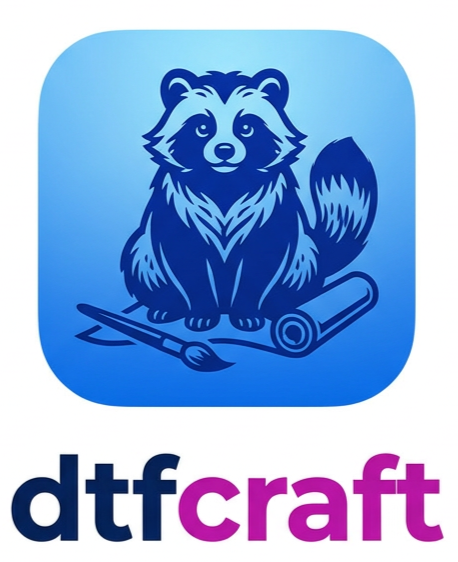

  

<h1 align="center">DTF Craft</h1>

  Logiciel de préparation de fichiers DTF (impression directe sur film), en développement. 
  Projet indépendant de Stéphane Glacet, construit sur la base de PhotoCraft.

## Le projet

DTF Craft réunit dans un seul logiciel les traitements utiles à la production DTF : préparer le
visuel pour le film, le contrôler avant impression, le placer sur la planche. Il fonctionne hors
ligne, sur le poste de l'atelier. La version 1.0 est prévue le 2 novembre 2026, pour Windows.

Outils en cours de développement :

- Halftone DTF
- Gang sheet
- Agrandissement IA hors ligne (Real-ESRGAN)
- Préparation impression : conformité, fond de contrôle, pixels transparents, suppression de
  frange, netteté, saturation

Le détail du menu DTF est dans [DTF-CRAFT.md](DTF-CRAFT.md).

## Licence

DTF Craft est distribué sous double licence MIT / Apache-2.0, au choix
([LICENSE-MIT](LICENSE-MIT), [LICENSE-APACHE](LICENSE-APACHE)), comme PhotoCraft.

- Usage, y compris commercial, modification et redistribution autorisés.
- En cas de redistribution : conserver les fichiers de licence, les mentions de copyright et le
  fichier [NOTICE](NOTICE). Les fichiers modifiés par rapport à PhotoCraft sont listés dans
  [MODIFICATIONS.md](MODIFICATIONS.md).
- Le nom et le logo DTF Craft, ainsi que le nom et les logos ArtCraft, ne sont pas couverts par la
  licence.

DTF Craft n'est pas un produit officiel PhotoCraft ou ArtCraft. Le README d'origine de PhotoCraft
est conservé dans [README-PhotoCraft.md](README-PhotoCraft.md).

## Versions officielles

Le développement est financé par souscription : 25 € TTC par version majeure (1.0, 2.0…), mises à
jour mineures incluses. Les exécutables Windows officiels sont fournis aux souscripteurs.

## Contact

Stéphane Glacet — contact@stephane-glacet.com
